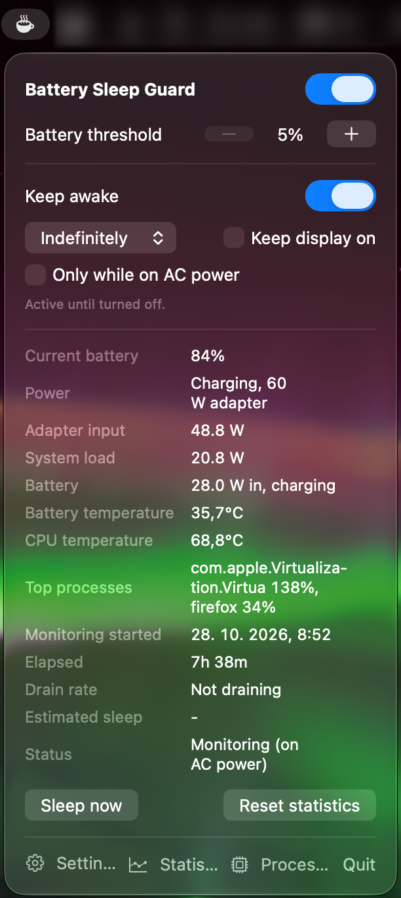
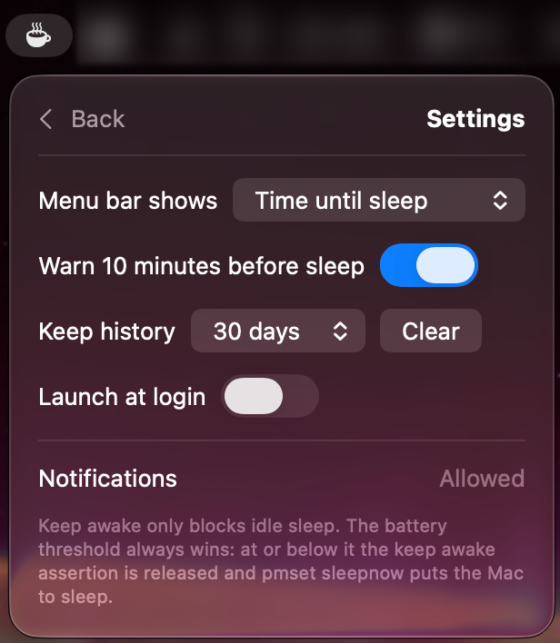
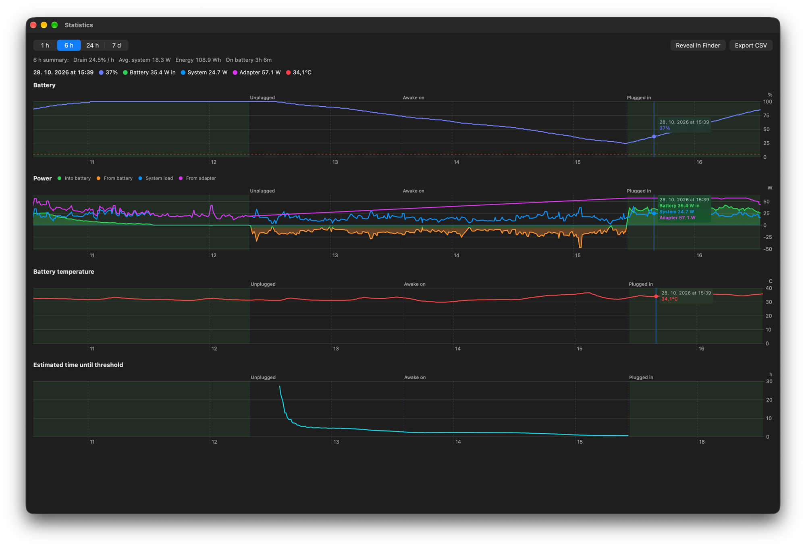
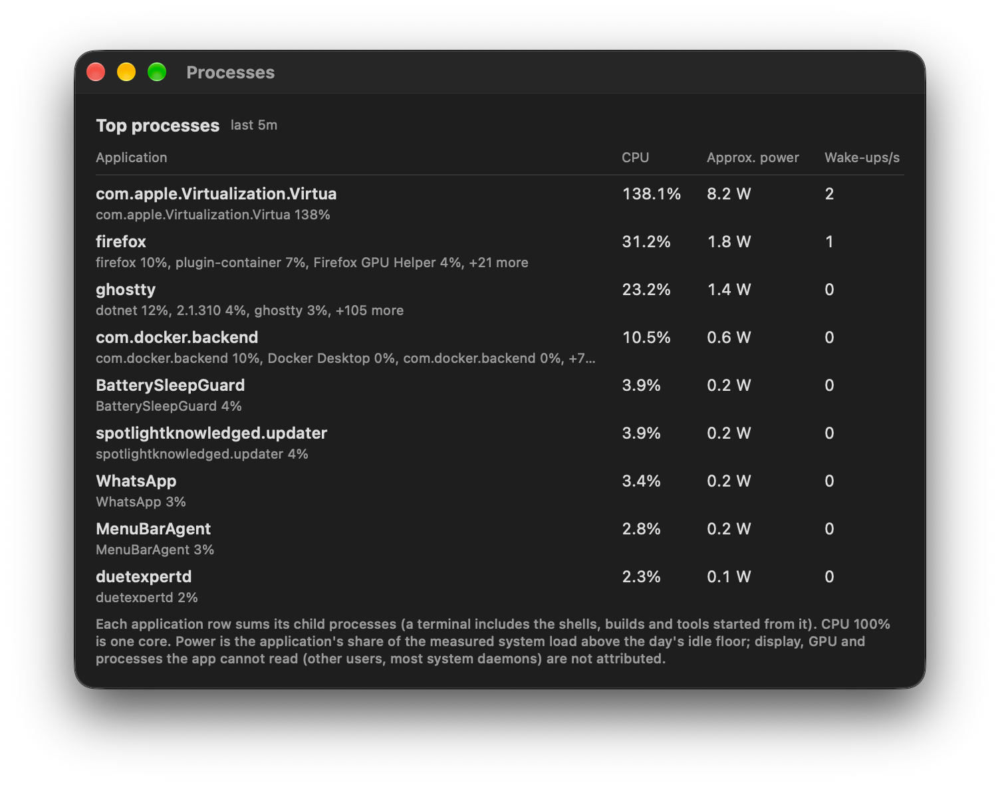

# macOS sleep on low battery

**Battery Sleep Guard** is a menu bar app that puts your Mac to sleep when the battery drops to a percentage you choose, even while something else is keeping it awake.

<p>
  
  
</p>

## tl;dr

`caffeinate`, Amphetamine, IDEs and AI coding agents hold a `PreventUserIdleSystemSleep` assertion. While it is held, a MacBook on battery never idle sleeps and runs down to 0%. Battery Sleep Guard watches the level and runs `pmset sleepnow` at your threshold. That is an explicit sleep request, which those assertions do not block, so the Mac goes to sleep anyway.

## Features

- **Sleep at a set battery level**, anywhere from 5% to 95%. It fires once per discharge. If you wake the Mac below the threshold, it stays awake so you can plug in.
- **Warning 10 minutes ahead**: a notification with the estimated sleep time.
- **Keep awake**, like Amphetamine: indefinitely or for a set time, optionally with the display on, or only while on AC power. The battery threshold always overrides it.
- **Live readings**: drain rate, time until sleep, adapter input, system power draw, battery flow, battery and CPU temperature.
- **Menu bar text**: time until sleep, battery %, remaining keep awake time, watts or temperature next to the icon.
- **Statistics**: charts of battery level, power, temperature and time to threshold over 1 h, 6 h, 24 h or 7 days, with plug in, unplug and other events marked. Exports to CSV.
- **Processes**: the apps using the most CPU and an estimate of their power draw, grouped the way Activity Monitor groups them (a terminal includes everything started from it).
- Runs without an admin password, helper tool or network access.





## Install

There is no prebuilt download yet, so you build it with Xcode. You need macOS 14 Sonoma or newer and Xcode 15 or newer.

```sh
git clone https://github.com/007hacky007/macos-sleep-on-low-battery.git
cd macos-sleep-on-low-battery
xcodebuild -project BatterySleepGuard.xcodeproj -scheme BatterySleepGuard \
  -configuration Release -derivedDataPath build build
cp -R build/Build/Products/Release/BatterySleepGuard.app /Applications/
open /Applications/BatterySleepGuard.app
```

You can also open `BatterySleepGuard.xcodeproj` and press Run. A moon icon appears in the menu bar. The app has no Dock icon.

Copy the app to `/Applications` before you turn on "Launch at login". The login item is registered at the app's current path, so a copy in a build folder breaks when that folder is cleaned.

The build is signed ad hoc, which is enough to run it on your own Mac. To give it to others, set your own team and bundle identifier (the placeholder is `com.example.BatterySleepGuard`) and notarize it.

## How it works

- Reads the battery through IOKit every 30 seconds, every 5 seconds while the window is open, and right away when you plug in or unplug.
- At the threshold on battery, it releases its own keep awake assertion and runs `pmset sleepnow`. If that fails, it calls `IOPMSleepSystem` directly. Any logged-in user may request sleep, so no sudo is involved.
- Keep awake blocks idle sleep only. Closing the lid still puts the Mac to sleep.
- History goes to `~/Library/Application Support/BatterySleepGuard/` and is kept for 1, 7 or 30 days.

The internals, stored data and project layout are in [docs/technical-details.md](docs/technical-details.md).

## Limitations

- On a Mac without a battery it does nothing.
- macOS reports the battery in whole percents, so the first drain estimate needs a few minutes on battery.
- Per process power is estimated from CPU time. GPU, display and other users' processes are not counted.
- App Sandbox is off, because a sandboxed app passes its sandbox on to `pmset`. That rules out the Mac App Store.

## Development

```sh
xcodebuild -project BatterySleepGuard.xcodeproj -scheme BatterySleepGuard \
  -destination 'platform=macOS' test
```

The Xcode project is generated from `project.yml`. After editing it, run `xcodegen generate` ([XcodeGen](https://github.com/yonaskolb/XcodeGen)).

## License

[MIT](LICENSE)
